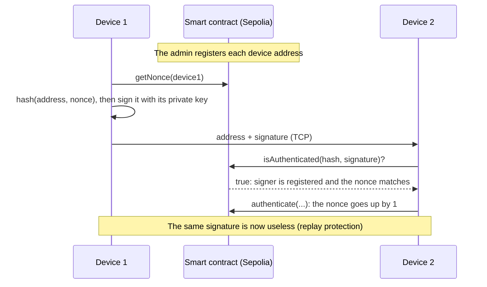

# IoT Device Authentication with an Ethereum Smart Contract

IoT devices prove who they are to each other with digital signatures. A smart contract on the
Ethereum **Sepolia** test network keeps the list of trusted devices and a nonce per device, so a
captured message cannot be replayed.

**Stack:** Solidity · Truffle · Python · Web3.py · eth-account · Infura (Sepolia)

## How it works



1. The **admin** registers device addresses in the contract (`registerDevice`), or revokes them (`revokeDevice`).
2. A device reads its current **nonce**, hashes `(its address, nonce)` and signs the hash with its Ethereum private key.
3. The other device asks the contract to check the signature: `ecrecover` finds the signer, which must be registered, and the hash must use the current nonce.
4. On success, the nonce goes up by 1, so an attacker who records the message cannot send it again.

## Repository structure

```text
truffle/
  contracts/IoTStrongAuth.sol     the smart contract
  migrations/2_deploy_contracts.js
  truffle-config.js               Sepolia network through Infura
iot_simulation/
  admin_interface.py              menu: create, register, revoke a device, show a nonce
  iot_device.py, iot_device2.py   two devices that authenticate each other (ports 6001 and 6002)
  utils/crypto_utils.py           hashing and signing
  utils/web3_config.py            contract connection and checks
  peers.txt                       the devices' addresses (host:port)
  IoTStrongAuth.json              contract ABI
```

## Run it

You need Python 3.10+, Node.js, an [Infura](https://www.infura.io/) project and Sepolia test ETH.

### 1. Deploy the contract

```bash
npm install -g truffle
cd truffle
npm install
# .env (never commit it): MNEMONIC=...  INFURA_PROJECT_ID=...
truffle compile
truffle migrate --network sepolia
```

Then put the new contract address in `iot_simulation/admin_interface.py` and `iot_simulation/utils/web3_config.py`.

### 2. Run the devices

```bash
cd iot_simulation
pip install -r requirements.txt
# .env (never commit it): INFURA_URL, PRIVATE_KEY, ADMIN_ADDRESS, PRIVATE_KEY_DEVICE1, PRIVATE_KEY_DEVICE2
python admin_interface.py   # register both devices
python iot_device.py        # terminal 1
python iot_device2.py       # terminal 2
```

## Security notes

- All private keys and the Infura URL come from a `.env` file, which is in `.gitignore`.
- Only the admin can register or revoke a device (`onlyAdmin`).
- Each successful login uses the nonce once, which blocks replay attacks.
- This is a research prototype on a test network. Never use real funds or real keys with it.

## Next steps

- [ ] Move from Truffle (no longer maintained) to Hardhat or Foundry, with unit tests for the contract
- [ ] Read the contract address from `.env` instead of the code
- [ ] Add a timeout so an old signature expires even if it was never used
